# OpenCPU用户开发环境搭建手册

## 1 虚拟机工具下载安装
### 1.1 下载
在vmware官方网站下载免费版本的[vmware player](https://my.vmware.com/en/web/vmware/downloads/info/slug/desktop_end_user_computing/vmware_workstation_player/16_0?wd=&eqid=e121f03b00008e38000000045fe5a1dd)：
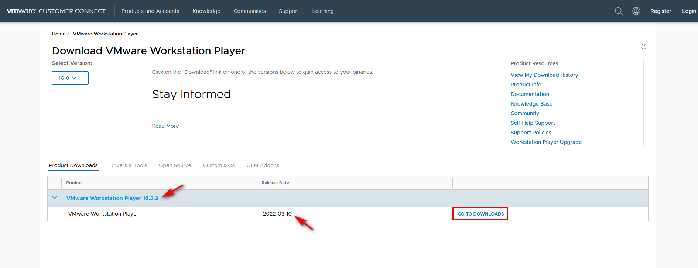

> **注意：版本可能会随时间更新，不影响使用**

### 1.2 安装
1. 打开安装程序，按照向导开始安装：
   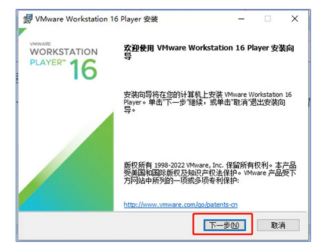
   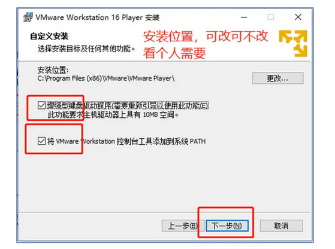
   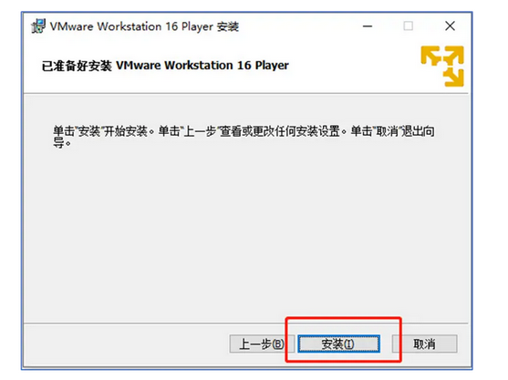
   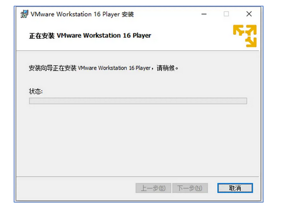
   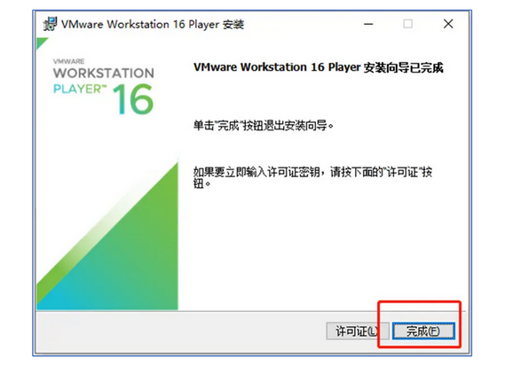
   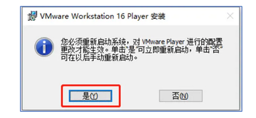
   2. 安装完成后重启系统。

## 2 Ubuntu系统下载安装
### 2.1 下载
到ubuntu官网下载[Ubuntu20.04 Desktop](https://ubuntu.com/download/desktop)，如下图：
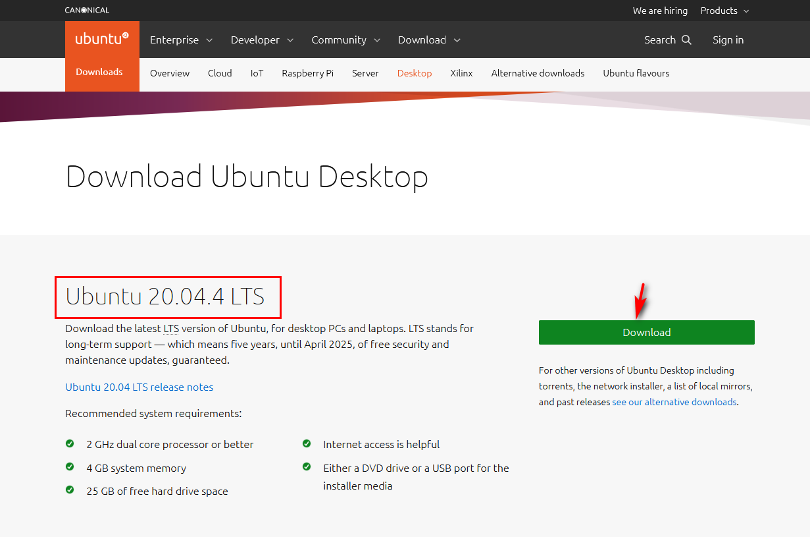

### 2.2 安装
1. 打开vmware player，新建一个linux虚拟机，如下图：
 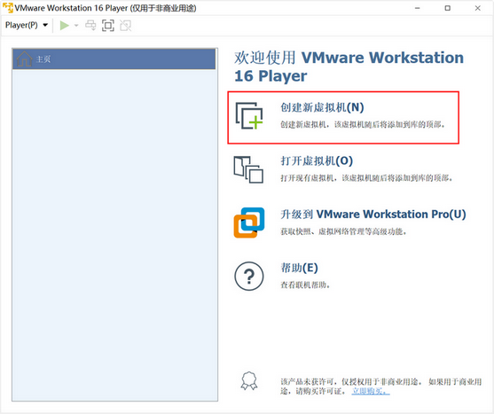
 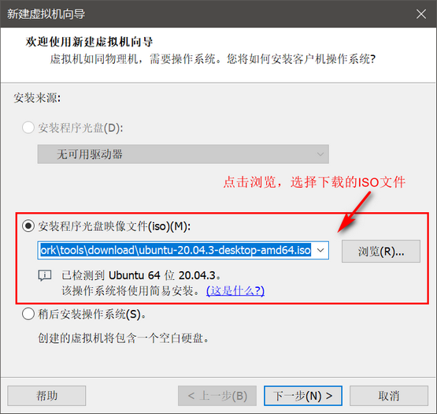
 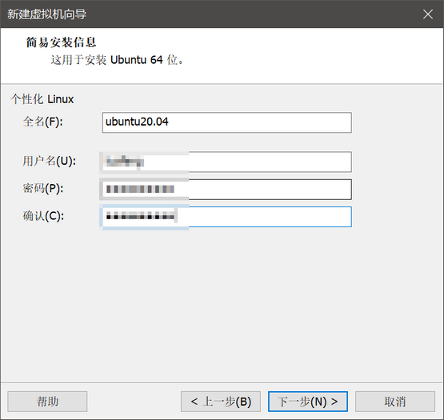
 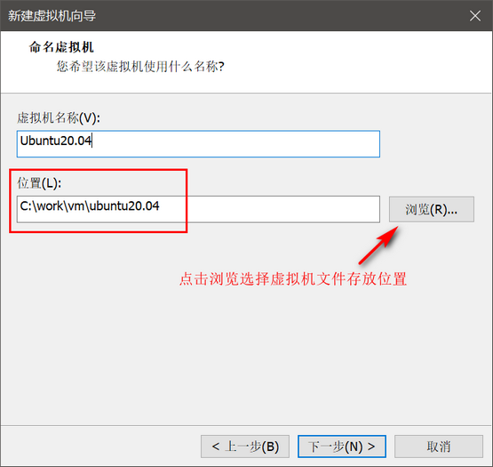
 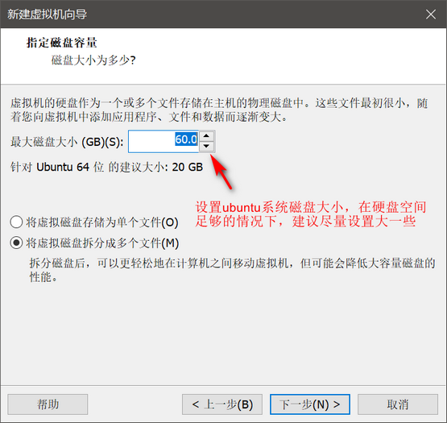
 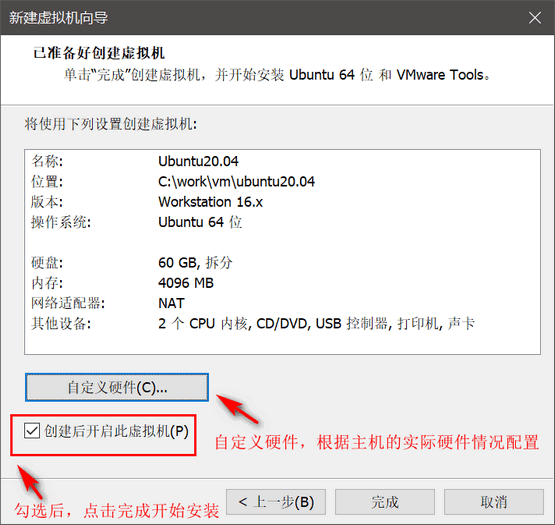
 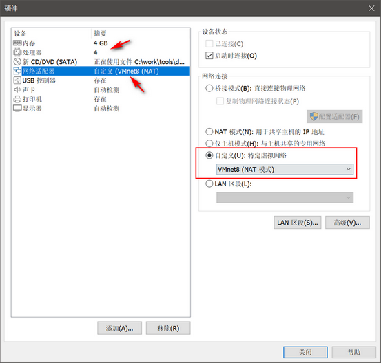

2. 完成虚拟机创建后，点击`完成`开始安装Ubuntu系统：
 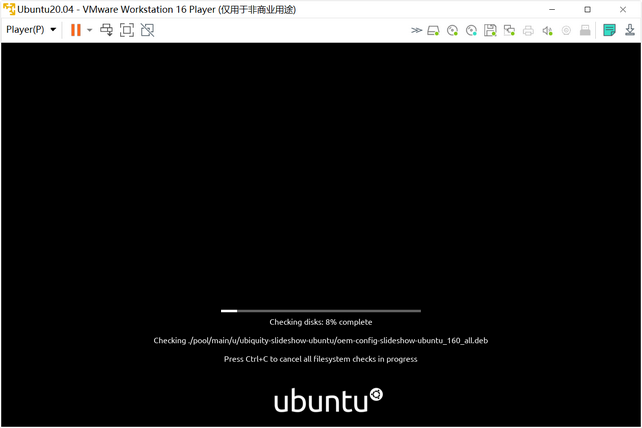
 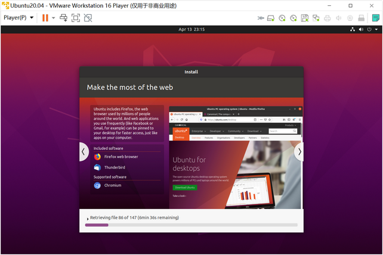
 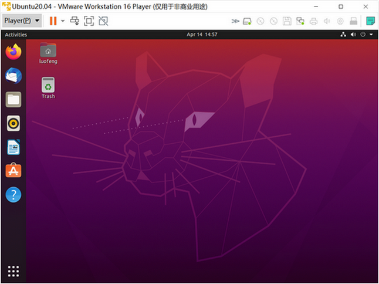

## 3 软件工具下载安装
### 3.1 Ubuntu工具
ubuntu环境主要负责软件编译，因此在该环境下需要在线安装开发环境依赖软件。
安装前，先检查ubuntu系统是否能正常联网。打开终端，
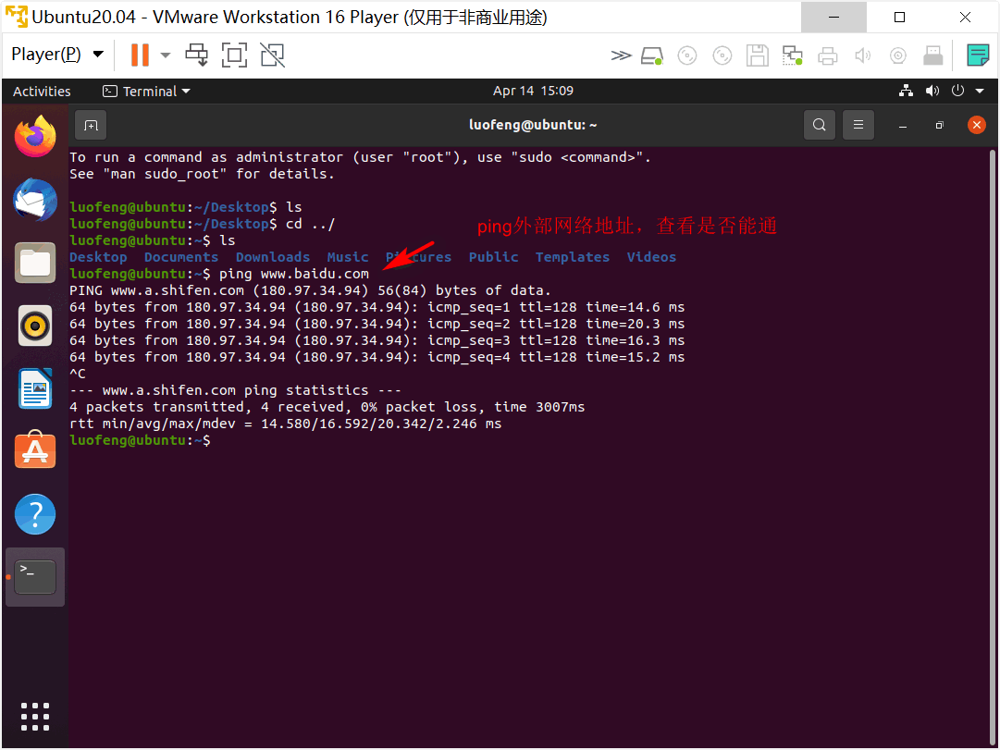
>  **如果网络不通，可以上网查找如何配置虚拟机网络，寻找解决方案。**

1. 网络正常的前提下，执行以下命令，安装开发环境依赖软件：
    ```bash
    cd ~
    sudo apt install build-essential python3 python3-tk qtbase5-dev
    sudo apt install libc:i386 libstdc++6:i386 zlib1g:i386
    sudo apt install net-tools
    sudo wget http://security.ubuntu.com/ubuntu/pool/main/i/icu/libicu55_55.1-7_amd64.deb
   sudo dpkg -i libicu55_55.1-7_amd64.deb
   ```
   
2. 安装配置samba共享环境，方便windows主机与ubuntu虚拟机之间共享访问SDK工程，执行以下命令:
    ```bash
    sudo apt install samba samba-common
    sudo smbpasswd -a <username>
    ```
    > **\<usrname\> 填写自己安装ubuntu系统时使用的用户名。**
    
    samba服务安装完成后，修改`/etc/samba/smb.conf`，添加共享目录：
    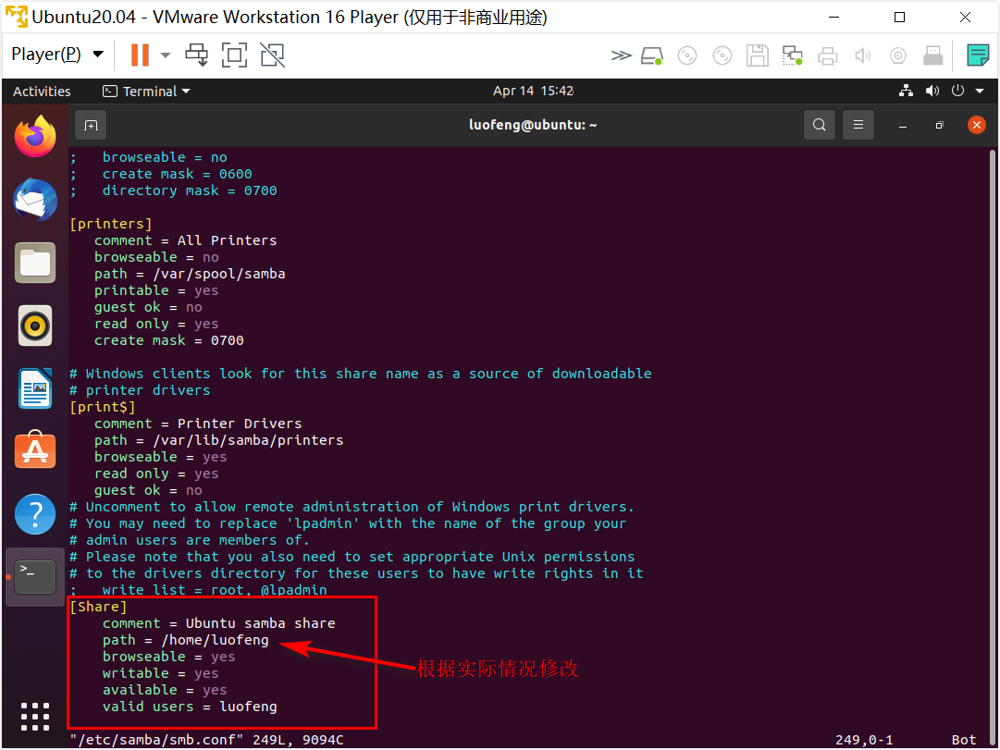
    
    执行以下命令重启samba服务：
    ```bash
    sudo service smbd restart
    ```

    查看Ubuntu系统IP，并在Windows下使用samba访问共享目录
    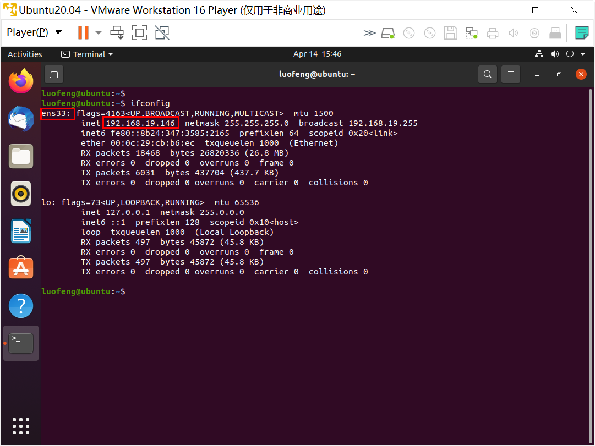
    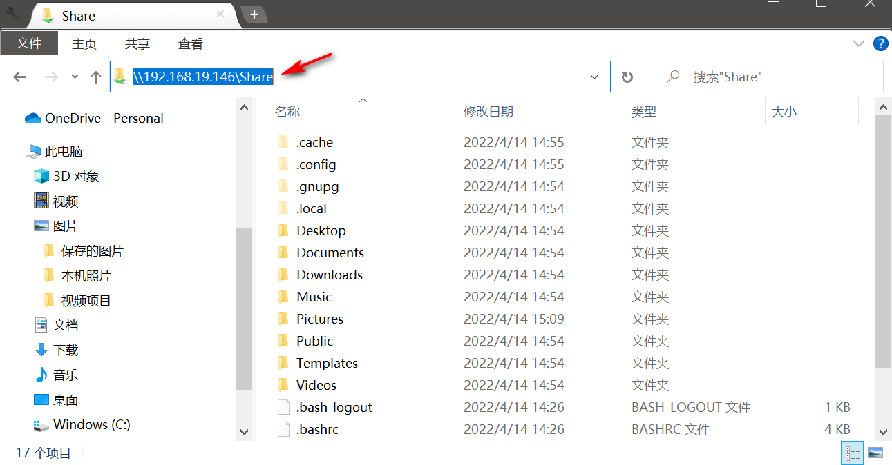

    > **如果Windows下无法访问共享目录，可上网查找如何配置Ubuntu samba共享**

3. 安装并启动SSH服务，执行以下命令：
    ```bash
    sudo apt install openssh-server
    sudo ufw allow ssh
    ```

### 3.2 Windows工具
Windows环境主要负责软件烧录，调试及日志查看等，因此需要在该环境下安装烧录、调试及日志查看工具。在涂鸦开发者网站或者向涂鸦支持人员获取相关工具安装包.
安装USB驱动，如图：


安装完成后，USB连接NL668-AM-00开发板，开发板启动成功后，在设备管理器中可以看到相关的端口，如图：


固件烧录工具解压，使用如图：


日志获取，使用Logel.exe，解压后打开，如图：


点击1，打开设置页面，按照红框设置，完成后：



点击红框开始抓取log。

## 4 开发板及SDK获取

### 4.1 开发板获取
与涂鸦模组销售人员联系，获取模组开发板：


### 4.2 SDK获取
在涂鸦开发者平台或者通过涂鸦IDE工具，完成正常的开发者账号和产品创建流程后，即可获取到模组SDK，并在ubuntu中解压：


## 5 程序开发及编译
### 5.1 程序开发

用户开始应用编程之前，需要了解各型号模组提供给用户使用的Flash空间情况，应用程序可执行文件大小不应该超过Flash空间大小。各型号模组提供给用户的Flash空间大小如下：

| 模组型号  | 应用程序Flash空间大小 |
| --------- | --------------------- |
| MC665-EU-19 | 512K             |

#### 5.1.1 SDK说明
SDK包解压完成后，进入TuyaOS目录，目录结构如下：


| 目录         | 说明                                           |
| ------------ | ---------------------------------------------- |
| apps         | 应用工程目录，所有应用程序代码工程放在该目录下 |
| cmake        | cmake基础脚本目录                              |
| components   | 系统库及头文件目录                             |
| docs         | 帮助文档目录                                   |
| include      | 涂鸦头文件目录                                 |
| ldscripts    | 编译链接脚本目录                               |
| libs         | 涂鸦SDK开发库目录                              |
| prebuilts    | 交叉编译工具链                                 |
| scripts      | 通用shell脚本目录                              |
| sysfw        | 系统固件目录                                   |
| tools        | SDK工具目录                                    |
| build_app.sh | 工程编译启动脚本                               |

#### 5.1.2 IDE开发环境安装
> - SDK解压后，用户可在`apps`目录下建立自己的应用开发工程。SDK发布时，在该目录下集成了若干demo工程，用户可以参考demo工程的样式创建新的应用工程。
> - 完成应用工程创建之后，用户可以使用自己喜欢的代码编辑工具（如vscode, source insight, vim, sublime text, atom等），完成应用工程的代码开发。除此之外，为方便用户在涂鸦SDK工程中开发应用，涂鸦也为用户提供了一套专用的IDE工具，下面介绍windows系统中IDE工具的安装及使用。

1. 下载并安装 [vscode studio](https://code.visualstudio.com/download)
    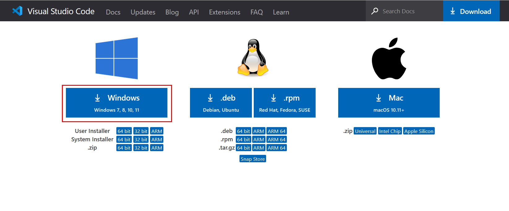

2. Ubuntu下安装python3.8及pip3
    ```bash
    sudo apt install python3.8
    sudo apt install python3-pip
    ```
    
    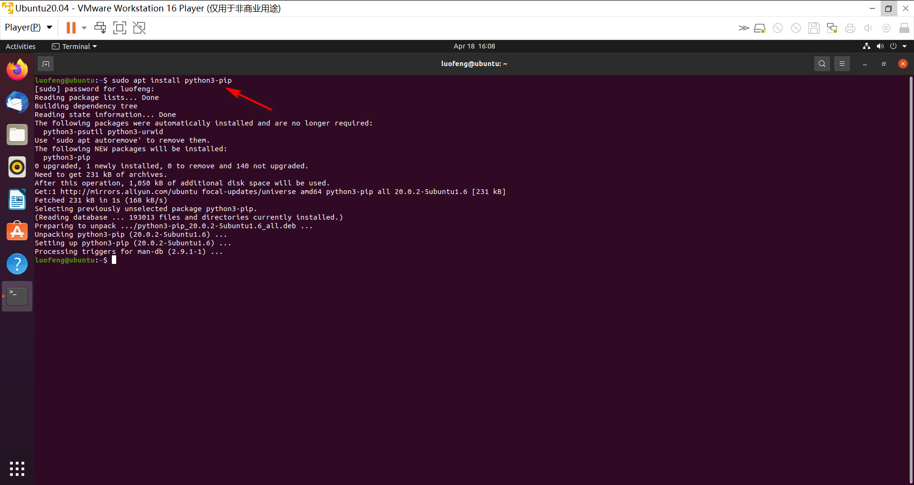
    
3. 重启电脑，打开`vscode studio`，安装`Remote SSH`插件
    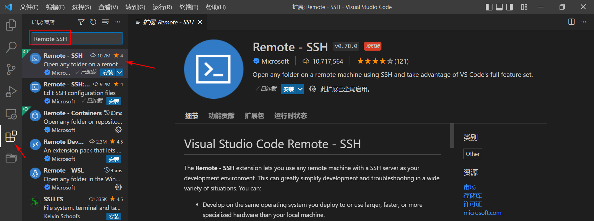
    
    安装完成后，开始SSH连接Ubuntu
    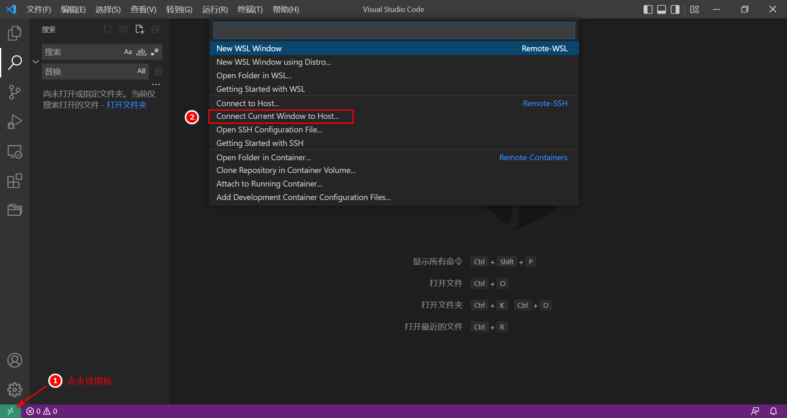
    输入Ubuntu系统IP地址，开始连接，并根据提示输入用户名和密码
    
    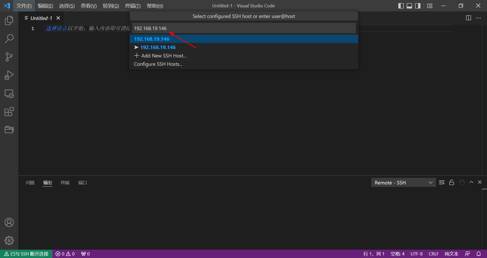

    连接成功后，在终端下能看到Ubuntu命令行
    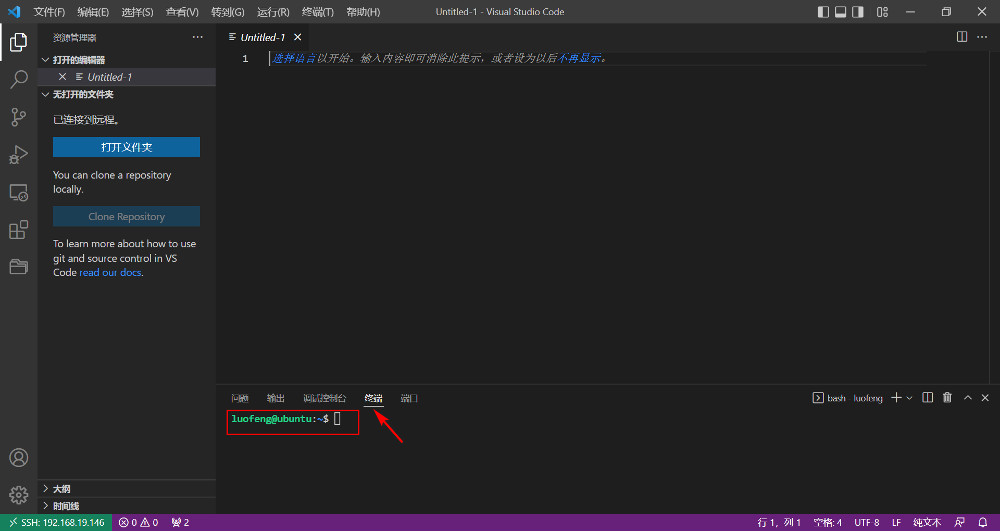
    
> 注意：如果SSH连接失败，可上网查找如何配置vscode SSH

4. 安装`Tuya Wind IDE`插件
    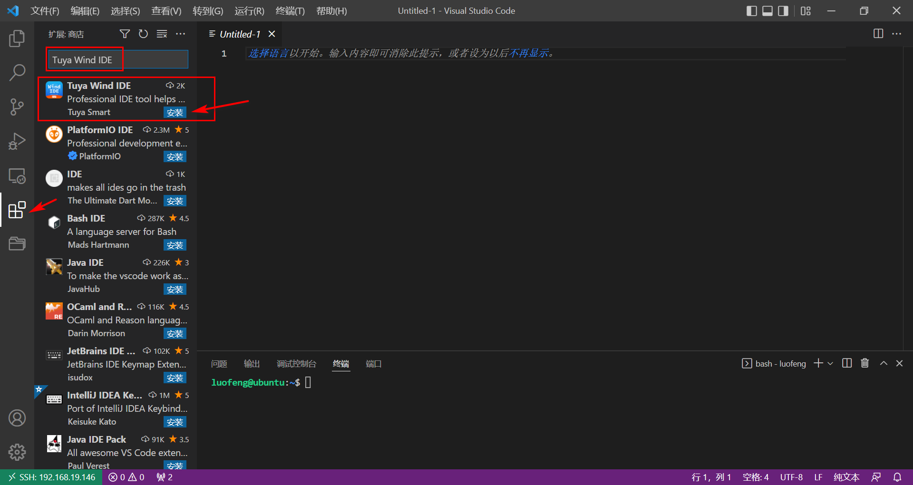
    安装完成后，重新装载插件
    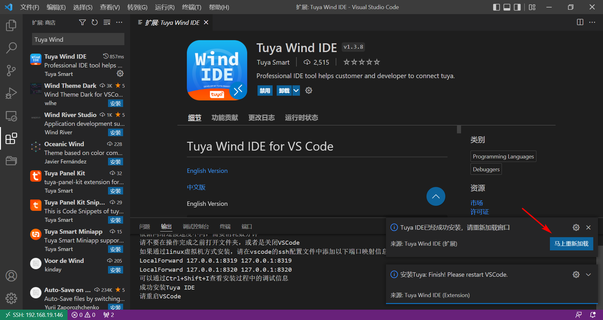

#### 5.1.3 IDE开发环境使用
1. IDE安装完成后，先在Ubuntu系统下将获取的SDK压缩包解压
   
2. 打开vscode studio，选择TuyaOS
    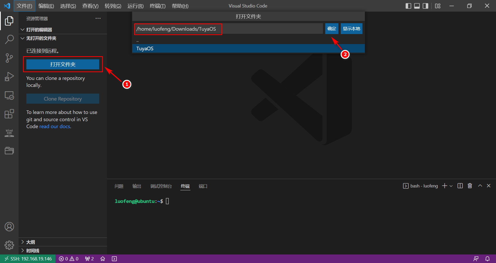

3. 成功打开后，出现SDK工程目录树
    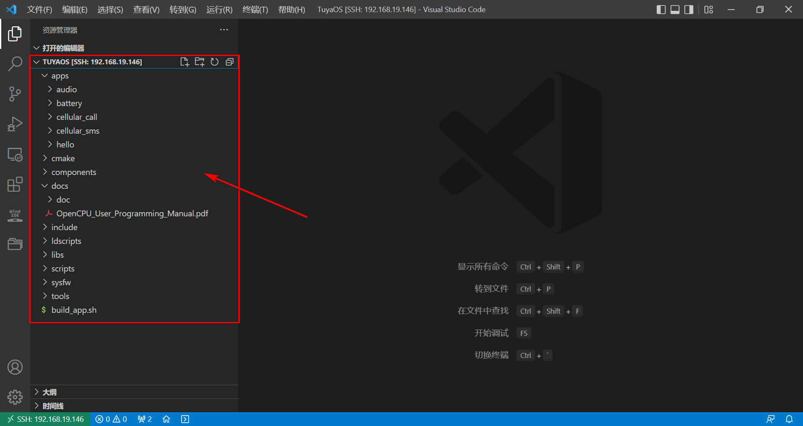

4. 通过菜单查看`demo`帮助文档，以及SDK手册
    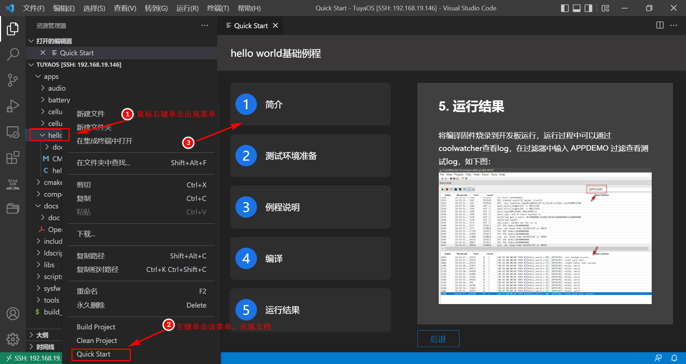
    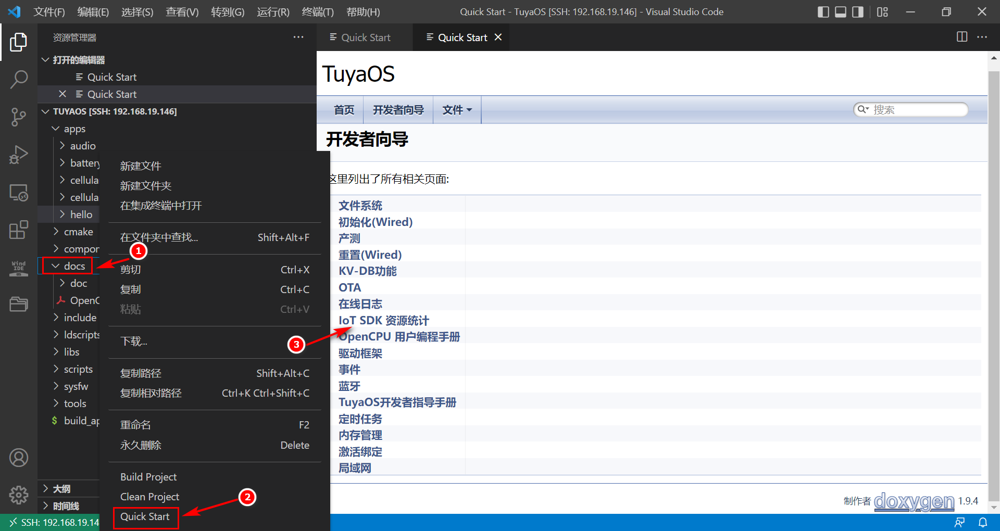

### 5.2 编译
支持两种编译方式：
1. Ubuntu系统命令行编译
    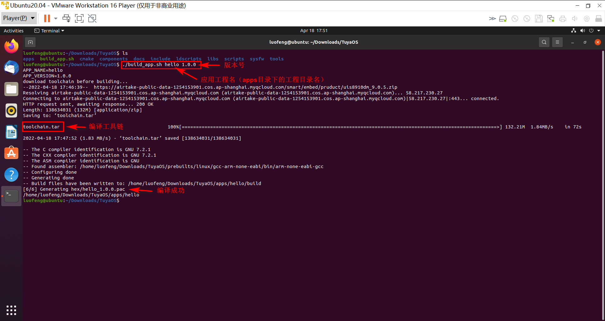
    
    > **第一次编译应用之前，会自动下载编译工具链并集成到SDK中。**

2. Tuya Wind IDE菜单编译
    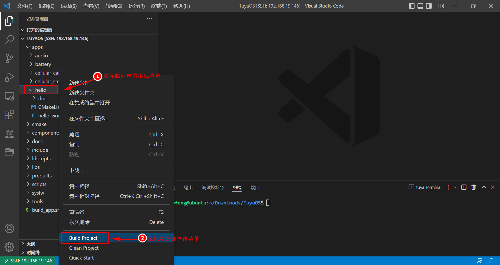
    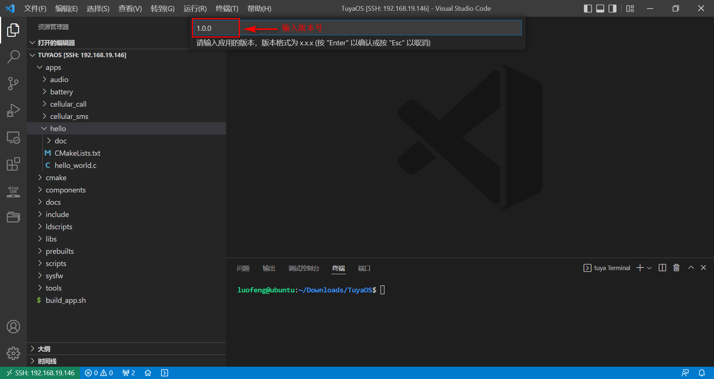
    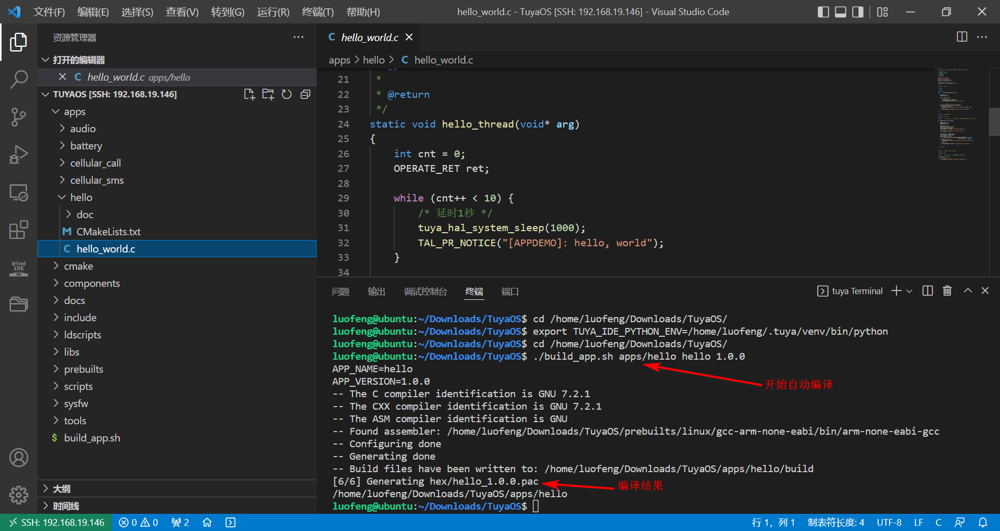

## 6 应用程序调试
1. 应用工程完成编译后，会按规则在apps/output/1.0.0目录下生成可烧录固件
    
    
    > **上图以hello工程为例，成功编译hello 1.0.0版本后，将在以上路径生成固件**
    
2. 使用烧录工具将hello_1.0.0.pac烧录到开发板，重启后，连接日志查看工具，可进行调试。
   