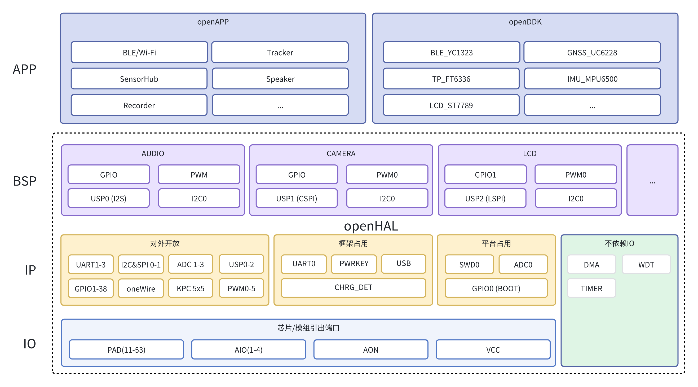
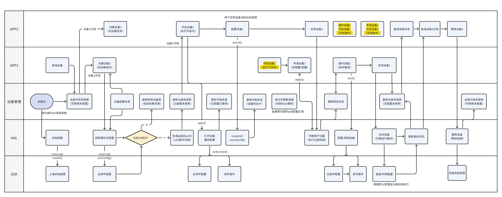

# openHAL

openHAL对硬件资源统一管理，对上层提供统一的硬件层API接口，对底层芯片层API如CMSIS进行二次封装，提供类Android Things、PikaPython、linux等风格接口。

* 提供可靠且稳定的标准化接口，统一管理外设，实现资源的灵活复用；
* 提供和主流软件平台兼容或适配的操作层，例如各种开源工程及系统；
* openHAL和openAPP、openDDK构建open开发框架，可用于对接各类SDK；




# 开发准则

* 暴露的接口尽量统一，用户可用的接口尽量全面，参数尽量封装在内部
* 时间测量接口，初始化对应时间数组，每次调用会计时，通过导出数据可以分析时间消耗

# 功能矩阵

| HAL | startup | create/delete | open/close | read/write | ioctl/pmctl | query |  
| ------ | ----- | ------ | ---- | ----- | ----- | ------ | 
| [PAD](#pad)   |  √  |  √  |  √  |  √  |  √  |  √  | 
| [GPIO](#gpio) |  √  |  √  |  √  |  √  |  √  |  √  | 
| [UART](#uart) |  √  |  √  |  √  |  √  |  √  |  √  | 
| [I2C](#i2c)   |  √  |  √  |  √  |  √  |  √  |  √  | 
| [KPC](#kpc)   |  -  |  -  |  -  |  -  |  -  |  -  |
| [SCR](#screen)|  -  |  -  |  -  |  -  |  -  |  -  |

* EC7XX系列PAD类比传统MCU的GPIO，具有唯一标识，作为其余外设的依赖；
* 除依赖IO的，还有DMA/TIM等不依赖IO的IP

## 接口分类

| OPEN API | param[in] | param[out] | return | brief | 
| ------- | ------- | ------- | ------- | ------- | 
| api_xxx_startup |  -  |  -  |  -  | 上电初始化
| api_xxx_default |  -  |  -  |  -  | 数据解析
| api_xxx_query  |  √  |  -  |  enum  |  查询接口
| api_xxx_create |  √  |    |  √  |  创建设备，动态表更新
| api_xxx_open   | timeout | inf | enum |  开启，回调，系统通知
| api_xxx_apply  | func |  cnf | enum |  预注册
| api_xxx_ioctl  | enum |    |    |  配置设备
| api_xxx_pmctl  | enum |    |    |  配置设备功耗/模式
| api_xxx_write  |  √ |  -  |    |  写操作
| api_xxx_read   |  - |  √  |    |  读操作
| api_xxx_close  | func | - | enum | 关闭，回调，系统通知
| api_xxx_delete | √ | - | enum |  删除设备，动态表更新 
| api_test_xxx   |    |    |    |  测试接口 


基本功能接口（兼容接口）：

* 获取/释放资源create()/delete() 
* 针对状态的查询接口 query()
* 针对设备的操作和配置 ioctl()
* startup()用于执行上电初始化，相关数据可配置传入或读特定区域flash
* default()用于解析对应数据存储到该模块的flash区域，结构化数据读取

调用类接口：

* create兼容传统api参数，实现对资源初始化，和delete接口都会更新设备列表
* open接口获取操作接口，超时返回，和close接口组合实现实现分时复用
* apply接口预申请资源，注册预配置接口，在预申请资源被释放同时执行
* ioctl是一个多功能可扩展接口，可配置硬件参数，直接操作底层设备

释放类接口：

* close接口用于释放设备占用，可传入执行函数用于配置在idle状态的执行内容
* delete将还原设备状态，发送系统通知，之后设备可以被重新create和apply

单元测试：

* 通过api_test_xxx()执行所有接口调用遍历，通过返回值确认执行情况

## 参考

### Android Things

```bash
gpio.setEdgeTriggerType(Gpio.EDGE_BOTH);
gpio.registerGpioCallback(mGpioCallback);
gpio.setDirection(Gpio.DIRECTION_OUT_INITIALLY_HIGH);// 低电平有效
gpio.setActiveType(Gpio.ACTIVE_LOW);...            // 将值切换为LOW
gpio.setValue(true);
```

### Pika Python

采用类linux的设计，所有类型的设备操作有且仅有类似于文件的5个标准API：open()、close()、write()、read()、ioctl()

```bash
pika_dev* pika_hal_open(PIKA_HAL_DEV_TYPE dev_type, char* name);
int pika_hal_close(pika_dev* dev);
int pika_hal_ioctl(pika_dev* dev, PIKA_HAL_IOCTL_CMD cmd, ...);
int pika_hal_read(pika_dev* dev, void* buf, size_t len);
int pika_hal_write(pika_dev* dev, void* buf, size_t len);
```

---

# 使用方式

```bash
SUBSYS_OPENHAL_ENABLE           = y
```

配置文件通过CSV表格打包，烧录内部文件系统，更新方式包括：

* 在工程路径下，通过编译打包直接烧录
* 通过Python脚本上传文件到文件系统

转存逻辑：从文件中提取配置信息生成响应数据结构体，再将对应的RAM结构体数据备份到指定区域，开机加载指定区域校验后写入硬件配置。

相较于devicemanage的目标芯片属性，openHAL支持更多外设资源扩展，可以作为驱动标准件。


## pad

| API | param[in] | param[out] | return | brief | 
| ------- | ------- | ------- | ------- | ------- | 
| [api_pad_startup](#api_pad_startup) | - | √ | √ | 加载默认配置
| [api_pad_default](#api_pad_default) |   |  -  | enum |  
| [api_pad_create](#api_pad_create) | paddr | config | enum |  申请接口
| [api_pad_open](#api_pad_open) | timeout |    | enum | 申请接口
| [api_pad_apply](#api_pad_apply) | cb |  | - |  申请接口
| api_pad_query  | paddr/usrId |  -  | enum |  查询接口
| api_pad_ioctl  |   |   |   | 配置接口 
| api_pad_pmctl  |   |   |   | 运行状态/功耗模式 
| api_pad_close  | usrId |    | enum |  关闭接口 
| api_pad_delete | usrId |    | enum |  删除接口 
| api_test_pad   | usrId |    |    |  测试接口 

* 如果其他虚拟设备占用了IO，需要从所有可用IO列表中删除对应IO，避免再分配

### api_pad_startup

默认配置数据导出，加载pad默认配置并初始化，配置文件存储区域固定，存储内容可通过文件升级方式更新；

### api_pad_default

默认配置数据的解析导入

### api_pad_create


### api_pad_open

系统级接口，和close接口成对使用，会malloc相应任务堆栈，依赖freeRTOS消息机制管理状态和超时。


```bash
api_ret_t api_pad_open(uint32_t usrId,PadConfig_t *config,uint32_t timeout);
```
* 如果在超时时间内，申请的usrId是free状态，则获取成功，并以传入的config参数初始化;
* 如果在超时时间内，申请的usrId是close状态，则获取成功，pad的配置参数以config传出;
* 超时未获取成功，通过open_hal_ack_t枚举返回状态;

### api_pad_apply

系统级接口，非阻塞，获取pad成功后回调，可用于共用外设端口情况

```bash
int api_pad_apply(uint32_t usrId,void *cb);
```

## gpio

* 当前实现是基于单IO为单位，所以不需要bit操作，如果以port为单位，可以进行16bit组合封装

## uart

## i2c

## kpc

```bash
KpcConfig_t kpcConfig;
KPC_getDefaultConfig(&kpcConfig);

kpcConfig.validRowMask = KPC_ROW_3 | KPC_ROW_2 | KPC_ROW_1 | KPC_ROW_0;
kpcConfig.validColumnMask = KPC_COLUMN_2 | KPC_COLUMN_1 | KPC_COLUMN_0;

// 480ms (12*40ms) autorepeat delay
kpcConfig.autoRepeat.delay = 12;

KPC_init(&kpcConfig, KPC_callback);
KPC_eventQueueInit();
KPC_startScan();
```